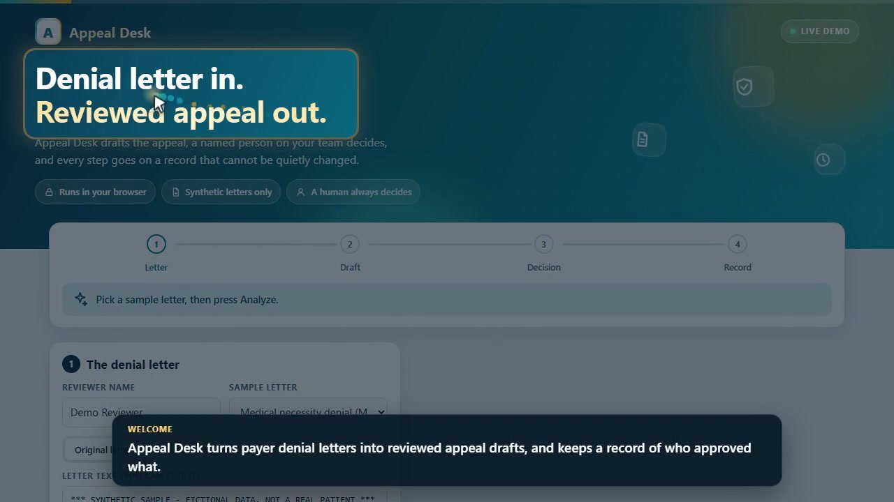
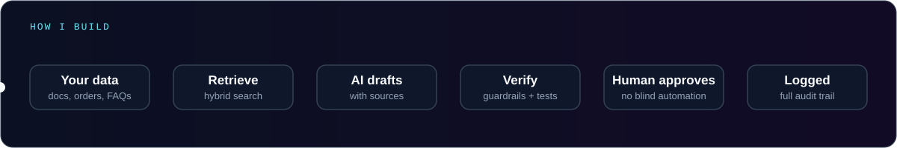

  

  
  
  

I build the layer between a business's documents and the answers its people and customers need: **RAG chatbots, AI agents and LLM apps** that run as real, tested code, not notebooks. Every answer is grounded in your own data, and a human stays in control of anything that matters.

## Featured: Appeal Desk

**Denial letter in. Reviewed appeal out.** Appeal Desk reads a US payer denial letter, drafts the appeal and flags deadlines and high-value claims. A named reviewer approves every draft, and every step lands in a tamper-evident audit trail.

  
  

## Projects

<table>
  <tr>
    <td width="50%"></td>
    <td width="50%"></td>
  </tr>
  <tr>
    <td width="50%"></td>
    <td width="50%"></td>
  </tr>
</table>

Each project runs end to end, has tests that run in CI on every push, and its README says plainly what is built and what is planned.

## How I build

## Stack

  
  
  
  
  
  
  
  
  
  
  
  

---

<b>Have a support inbox, a document pile or a manual process that eats your team's day?</b> 
<a href="mailto:zeeshanqadir568@gmail.com">Email me</a> and I'll tell you honestly whether AI can fix it.

