  

  
  
  

<h3 align="center">Your team answers the same questions all day. I build AI that does it for them.</h3>

From your own documents. With sources. With a human in control.

## What I deliver

- 💬 **Chatbots that don't make things up.** Answers come only from your docs, and every answer shows its source.
- 🤖 **AI agents that do real work.** They look up orders, draft replies, open tickets, and hand off to a person when unsure.
- 📄 **Document automation.** Letters, forms and PDFs go in. Ready-to-approve drafts come out.
- 🛡️ **Built to be trusted.** Guardrails, audit logs, and tests that run on every push.

## Featured: Appeal Desk

Built for US medical billing teams who are buried in insurance denials:

- 📥 **Reads** the payer's denial letter
- ✍️ **Drafts** the appeal for that exact denial
- ⏰ **Flags** deadlines and high-value claims first
- ✅ **A named reviewer approves** every draft, and every step goes on a record that can't be quietly changed

  
  

## Projects

<table>
  <tr>
    <td width="50%"></td>
    <td width="50%"></td>
  </tr>
  <tr>
    <td width="50%"></td>
    <td width="50%"></td>
  </tr>
</table>

> **No vaporware.** Every project runs end to end, has tests in CI, and its README says honestly what's built and what's planned.

## How I build

## Stack

---

